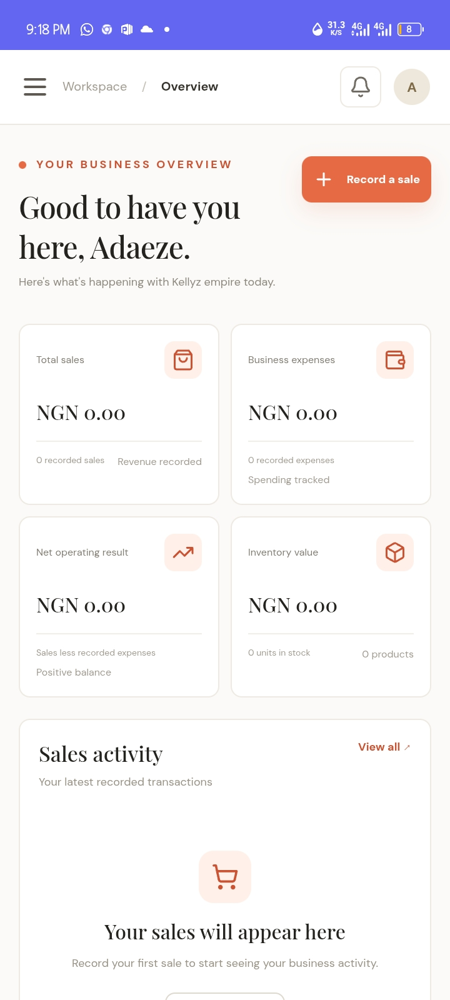
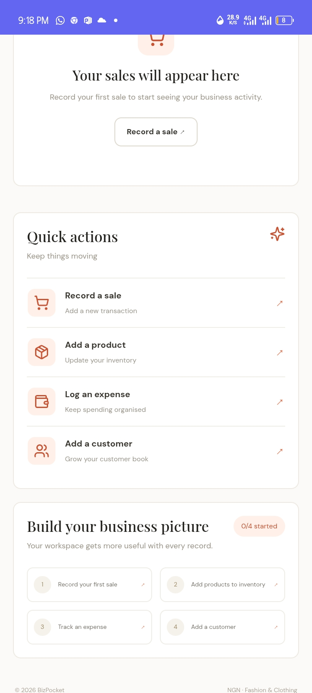
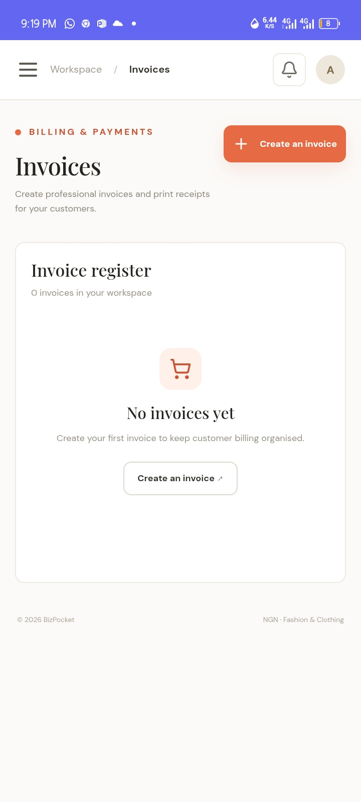
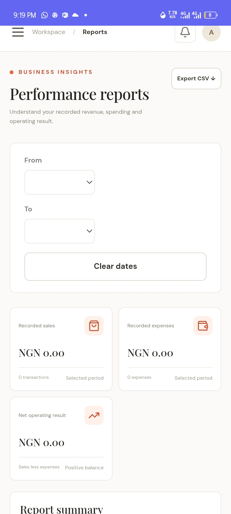

BizPocket

Business, Beautifully Managed.

BizPocket is a modern business management application designed to help small businesses organize their daily operations in one place.

It provides a centralized dashboard for managing sales, inventory, expenses, customers, invoices and business performance.

Live Demo: https://bizpocket-r025lz.v2.appdeploy.ai/

Features

- Business Dashboard: View important business information in one place.
- Sales Management: Record and manage business sales.
- Inventory Management: Keep track of products, prices and quantities.
- Expense Tracking: Organize and monitor business expenses.
- Customer Management: Store customer information and outstanding balances.
- Invoice Management: Create invoices and track payment status.
- Business Reports: Access business performance information.
- Multiple Currencies: Supports Nigerian Naira (NGN), Ghanaian Cedi (GHS), US Dollar (USD) and British Pound (GBP).
- User Authentication: Protected access to individual business workspaces.

Technology Stack

- React 19
- TypeScript
- Vite
- Tailwind CSS
- Lucide React
- AppDeploy backend and authentication services

Project Purpose

BizPocket was created to make business organization simpler and more accessible, particularly for small businesses that need an organized way to manage everyday operations.

Project Status

Active development.

Author

Created by Ezechinyere Adaeze Deborah.

Live Application

https://bizpocket-r025lz.v2.appdeploy.ai/
## 📸 Application Screenshots

### Dashboard

### Quick Action

### Invoices 

### Business Performance 

